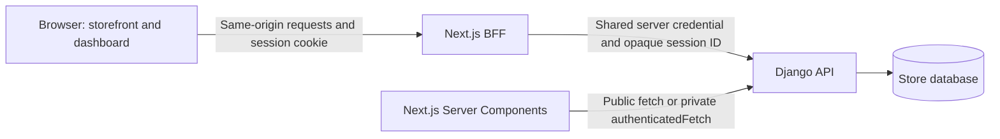

# eStore Frontend

A Next.js storefront and staff dashboard shared by four demo stores: **iPlug**, **Oak & Loom**, **TyrePapa**, and **Olive & Aura**. Each deployment selects its branding and page composition at build time and connects to its own Django API.

Companion repository: [eStore Backend](https://github.com/bernarddwumfour/estore-backend).

## Contents

- [Features](#features)
- [Architecture](#architecture)
- [Requirements](#requirements)
- [Local setup](#local-setup)
- [Environment variables](#environment-variables)
- [Authentication and sessions](#authentication-and-sessions)
- [Rendering and caching](#rendering-and-caching)
- [Store templates](#store-templates)
- [Project structure](#project-structure)
- [Development and testing](#development-and-testing)
- [Deployment](#deployment)
- [Troubleshooting](#troubleshooting)

## Features

**Storefront**

- Product and variant discovery, search, filters, sorting, pagination, product reviews, and promotions.
- Cart, wishlist, guest and customer checkout, payment returns, order history, and order details.
- Customer registration, login, verification, password recovery, profiles, and affiliate earnings.
- Services, service requests, appointment review flows, blog posts, and store information pages.
- Shopping assistant with guest and signed-in conversation behavior.

**Staff dashboard**

- Products, categories, variants, stock, services, service options, and appointments.
- Orders, transactions, shipping, point of sale, customer accounts, staff, and affiliates.
- Sales/product/user analytics, promotions, discounts, reviews, blogs, and email campaigns.
- Social accounts, posts, comments, and an inbox with streaming refresh notifications.
- Reusable design templates, categories, groups, saved instances, assets, and a canvas editor.
- Admin assistant, AI controls, store settings, and application logs.

Provider-dependent features require the corresponding backend credentials. Demo pages and illustrative artwork are not a guarantee that payments, shipping, email, or social accounts have been configured.

## Architecture

The application uses Next.js **16.0.10**, React **19.2.1**, TypeScript, Tailwind CSS 4, Radix UI, TanStack Query/Table, Zustand, Axios, React Hook Form/Zod, Recharts, and Fabric. Dependency versions are recorded in [package.json](package.json) and [package-lock.json](package-lock.json).



The BFF lives under `/api/bff/...`. It handles browser API traffic without exposing Django access or refresh tokens. Public Server Components fetch their data directly from Django; private Server Components use a server-only authentication helper rather than make a request back to their own BFF route.

## Requirements

- Node.js **22.13+ within the 22.x release line**, or **24+**, and npm. This covers the local profile loader's `node:util.parseEnv` use and the installed test tooling's engine requirements.
- A configured Django backend for the selected store.
- Access to that store's database and provider integrations through the backend; the frontend does not connect directly to the database or Redis.

## Local setup

```bash
git clone https://github.com/bernarddwumfour/estore-frontend.git
cd estore-frontend
npm ci
```

Create the environment profile for the store you want to run. These files are ignored by Git and must be created on a fresh checkout.

| Store | Profile | `NEXT_PUBLIC_STORE` | Frontend | Backend | Command |
| --- | --- | --- | --- | --- | --- |
| iPlug | `.env.iplug` | `default` | 3000 | 8000 | `npm run dev:iplug` |
| Oak & Loom | `.env.oakandloom` | `furniture` | 3001 | 8001 | `npm run dev:oak` |
| TyrePapa | `.env.tyrepapa` | `tyrepapa` | 3002 | 8002 | `npm run dev:tyrepapa` |
| Amammre Wears | `.env.amammre` | `amammre` | 3004 | 8004 | `npm run dev:amammre` |
| Olive & Aura | `.env.oliveandaura` | `oliveandaura` | 3003 | 8003 | `npm run dev:oliveandaura` |

Example `.env.iplug`:

```dotenv
NEXT_PUBLIC_STORE=default
NEXT_PUBLIC_API_BASE_URL=http://localhost:8000/api
DJANGO_API_URL=http://localhost:8000/api
BFF_ORIGIN=http://localhost:3000
BFF_SHARED_SECRET=replace-with-the-matching-backend-secret
REVALIDATE_SECRET=replace-with-the-matching-revalidation-secret
```

Use the matching ports and store value for the other profiles. Generate each shared secret once, then configure the **same value on both servers**:

```bash
node -e "console.log(require('node:crypto').randomBytes(48).toString('base64url'))"
```

Start the backend and apply its migrations first. Then run the frontend command from the table and open its localhost URL. The profile runner isolates Next.js output per store. Amammre Wears uses its own local API profile and database.

`npm run dev` uses Next.js's normal environment loading and default port. It does not select a named profile. The configured demo workspace uses `.env` as the default iPlug environment. Restart development processes after changing environment values.

## Environment variables

[.env.bff.example](.env.bff.example) provides BFF placeholders. Actual store profiles are local files, not deployment configuration.

| Variable | Purpose |
| --- | --- |
| `NEXT_PUBLIC_STORE` | Build-time template selection: `default`, `furniture`, `tyrepapa`, `oliveandaura`, or `amammre`. Unknown values fail explicitly. |
| `NEXT_PUBLIC_API_BASE_URL` | Public Django API URL, including `/api`; used by catalog and other public fetches. |
| `MEDIA_IMAGE_ORIGINS` | Comma-separated HTTP(S) origins allowed by Next.js for uploaded media from S3-compatible storage or a CDN. Configure at build time and restart/rebuild after changes. |
| `DJANGO_API_URL` | Server-side Django API URL, including `/api`; falls back to the public API URL if absent. |
| `BFF_SHARED_SECRET` | Server-to-server credential matching Django's value. Never prefix it with `NEXT_PUBLIC_`. |
| `BFF_ORIGIN` | Exact storefront origin, including scheme and development port, without a trailing slash. Required for production mutations. |
| `BFF_CLIENT_IP_HEADER` | Optional trusted ingress header used for client-IP forwarding. Only configure a header the hosting proxy overwrites. Vercel deployments default to `x-vercel-forwarded-for`. |
| `REVALIDATE_SECRET` | Separate server-only credential matching Django's storefront revalidation secret. |
| `NEXT_DEV_DIST_DIR` | Output-directory override used by the local profile runner. Normally omit in hosted deployments. |
| `PORT` | Optional development port override; an override also requires the corresponding origin configuration. |

Each store should have its own backend URL, database, BFF secret, and revalidation secret. Public variables are compiled into the frontend build; changing them requires a rebuild.

## Authentication and sessions

1. Customer or staff login goes through the BFF to Django.
2. Django validates credentials and creates a random browser session. Its database stores only the session ID's SHA-256 digest, associated user, password fingerprint, and expiry.
3. Next.js sets the opaque ID in a host-only, store-specific `HttpOnly; SameSite=Lax` cookie. Production cookies also use `Secure` and the `__Host-` prefix.
4. For subsequent requests, Next.js sends `X-BFF-Key` and `X-BFF-Session` to Django. Django validates the BFF identity and session before applying role and resource-ownership checks.
5. Sessions expire after seven days. Logout deletes the session; password changes and account deactivation invalidate it on subsequent requests.

The shared secret identifies **the Next.js server**. The session ID identifies **the signed-in user**. Neither replaces authorization checks.

Browser JavaScript stores no access or refresh tokens. `AuthProvider` restores user information through the profile endpoint and exposes loading, authenticated, unauthenticated, or error status. Logout/account changes clear private React Query state; tabs exchange a timestamp notification rather than credentials. Legacy `auth_data` cookies are removed and users must sign in again after migration.

BFF mutations require an exact matching Origin and the `X-Estore-CSRF: 1` custom header. This is a custom-header CSRF defense, not a secret token: cross-origin custom-header requests require a preflight, which the BFF does not authorize. Do not add permissive CORS to these routes.

The proxy restricts upstream paths, discards browser-supplied authorization/BFF headers, strips credential fields from JSON, rejects upstream redirects and debug HTML, and marks responses `no-store`. Multipart bodies and SSE are supported. The assistant namespace's trailing slash is normalized for Django.

The session implementation uses Django's database and requires **no Redis connection from Next.js**. Existing direct JWT API clients retain their separate backend behavior.

## Rendering and caching

| Area | Behavior |
| --- | --- |
| Dashboard | Interactive Client Components and React Query beneath a server-validated staff layout. Every API request is separately authorized. |
| Private server-rendered pages | `authenticatedFetch` reads the session cookie and calls Django directly with `cache: 'no-store'`. |
| Public product lists | Server Components preserve filtering, pagination, cache tags, and five-minute revalidation; random sorting is uncached. |
| Product details | Fresh data requests; template composition remains server-rendered. |
| Wishlist/cart/account controls | Client interactions layered on the storefront; authenticated calls use the BFF. |
| Checkout | Waits for session initialization; a session-service failure is not silently treated as guest checkout. |
| Social inbox | Streams events through the BFF, reconnects, and retains polling fallback behavior. |

Django invalidates storefront content after relevant writes through these fixed endpoints:

| Endpoint | Content |
| --- | --- |
| `POST /api/revalidate/blog` | Blog lists and affected post URLs, including old slugs. |
| `POST /api/revalidate/categories` | Cached category displays. |
| `POST /api/revalidate/products` | Product/variant listings and relevant category counts. |
| `POST /api/revalidate/services` | Service catalog cache and page. |

Callbacks use `Authorization: Bearer <REVALIDATE_SECRET>`. Django's `STOREFRONT_BASE_URL` identifies the target storefront. A failed callback does not remove the existing time-based cache fallback. Stock changes trigger product invalidation when availability crosses the in-stock/out-of-stock boundary. An admin “Live on store” message means the callback was accepted, not that a shopper's browser was checked.

## Store templates

[src/templates/registry.ts](src/templates/registry.ts) chooses a template at build time. Store overrides extend the default contract, sharing data access and interactions rather than duplicating the application.

- `default`: iPlug baseline.
- `furniture`: Oak & Loom presentation.
- `tyrepapa`: TyrePapa homepage, navigation, footer, and product presentation, with shared/default fallbacks. Asset notes live in [public/tyrepapa](public/tyrepapa) and [ASSETS.md](src/templates/tyrepapa/ASSETS.md).
- `beauty`: Olive & Aura presentation, selected with `oliveandaura`. Homepage treatment descriptions and sample prices are frontend content; do not assume they are synchronized to the backend service catalog.

Storefront templates are distinct from the dashboard's **design-template editor**, which manages reusable canvas content and saved instances through Django's templates API.

## Project structure

```text
src/app/(web)/           Public storefront and customer pages
src/app/(auth)/          Customer authentication screens
src/app/admin/login/    Staff login
src/app/dashboard/      Staff screens and server layout/client shell
src/app/api/bff/        Browser-facing API proxy
src/app/api/revalidate/ Backend-triggered cache invalidation
src/templates/          Store template contracts and overrides
src/widgets/            Shared UI and feature widgets
src/lib/server/         Server-only API/authentication helpers
src/lib/providers/      Auth and application providers
src/lib/auth/           Store-specific cookie naming
src/axios-instances/    Authenticated and guest browser clients
src/app/lib/            Shared client hooks and Zustand stores
src/constants/endpoints/ API paths
public/                 Store artwork and static assets
scripts/dev-store.mjs   Local store profile runner
```

## Development and testing

```bash
npm test
npm run test:watch
npm run lint
npx tsc --noEmit
npm run build
npm start
```

Run focused authentication coverage with:

```bash
npx vitest run src/lib/providers/auth-provider.test.tsx src/lib/server/bff-policy.test.ts 'src/app/api/bff/[...path]/route.test.ts'
```

Tests use Vitest, jsdom, and Testing Library. BFF tests cover session cookies, credential stripping, origin checks, multipart forwarding, SSE, public password recovery, and failure handling. They do not replace testing actual hosting upload limits or streaming duration.

Follow [RULES.md](RULES.md): reuse widgets, use React Query for server state, centralize API paths, and provide clear mutation feedback.

**Recorded verification, 2026-11-22:** 19 focused authentication tests pass. The broad run reported four failures in existing Cart, DataTable, and Slider expectations. Full TypeScript checking also reported an extra `ProductDetailPageContent` export in generated Olive & Aura product-route types; source checking without generated route validators passed. These are outstanding checks, not a claim that the full production build is green.

## Deployment

Deploy one frontend project per store on a Node-capable Next.js host. A static export cannot run the BFF or private server-rendered pages.

1. Deploy the matching Django backend and apply all migrations, including `users.0024_browsersession`.
2. Set the build-time store selection and public API URL in the hosting project.
3. Set `DJANGO_API_URL`, matching `BFF_SHARED_SECRET`, the deployed `BFF_ORIGIN`, and matching `REVALIDATE_SECRET` in the server environment.
4. Configure Django's frontend/storefront origins, allowed hosts, provider callbacks, and trusted-origin settings for that deployment.
5. Install with `npm ci`, build with `npm run build`, and run the host's Next.js runtime or `npm start`.
6. Verify customer/staff login, reload, logout, private orders, guest checkout, payment return, upload, and inbox streaming on the deployed origins.

Use deployed API addresses, not localhost. Ignored `.env.*` profiles are not uploaded when you push Git. Runtime-only changes cannot switch the compiled store template. Keep `/api/bff` responses out of shared CDN caches. Configure trusted ingress client-IP forwarding so Django's IP-based limits do not group all visitors under the BFF's egress address.

The inbox backend emits streams lasting up to 45 seconds; hosting function duration and buffering must permit that behavior. File sizes must fit both frontend-host and Django limits. Use a separate revalidation secret from the BFF secret.

## Troubleshooting

| Symptom | Check |
| --- | --- |
| Login/session service returns 503 | `DJANGO_API_URL`, backend reachability, and BFF secret configuration. |
| Login succeeds upstream but BFF returns 502 | Backend BFF code/migration must be deployed; legacy JWT-only login responses are rejected. |
| Mutation returns 403 | Exact `BFF_ORIGIN`, request Origin/custom header, then backend role permissions. |
| Session disappears after password change | Expected: password fingerprints invalidate existing sessions. |
| Every visitor hits login rate limits | Verify trusted client-IP forwarding; do not accept a spoofable header. |
| Wrong store or branding | `NEXT_PUBLIC_STORE` and the build/profile used to start the process. |
| Catalog looks stale | Matching revalidation secrets, reachable callback origin, then cache lifetime. |
| Database relation for browser sessions is missing | Apply backend migrations to the selected store database. |
| Assistant calls redirect or fail | Keep assistant trailing-slash normalization in the BFF. |
| Upload or inbox stream fails only when hosted | Check platform body-size, execution-duration, and buffering limits. |
| New profile fails to start | Create its ignored env file; the profile loader does not generate credentials. |
